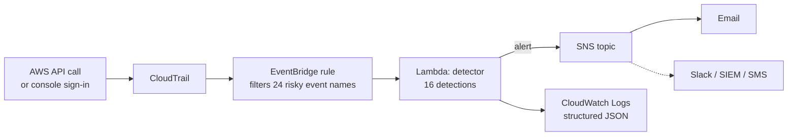

# cloudtrail-threat-detector


Real-time detection of risky AWS activity. A small Python Lambda watches CloudTrail through EventBridge and emails you within seconds when something looks like an attack: root logins, someone turning off CloudTrail or GuardDuty, a new backdoor admin user, SSH opened to the internet, a bucket made public.

Every alert says **who** did it, **from where**, **what changed**, and maps to a **MITRE ATT&CK** technique. Everything deploys with one `terraform apply`.

## Why I built this

My [aws-iam-auditor](https://github.com/CasimirTerr/aws-iam-auditor) finds misconfigurations that already exist. That's half the job. The other half is catching the moment something risky happens, because attackers in AWS follow a predictable playbook: get credentials, turn off logging, create a backdoor user, then expose or destroy data. Each of those steps leaves a CloudTrail event, and this project turns those events into alerts a person will actually read.

## Architecture



EventBridge drops everything except the event names the rules care about, so the Lambda only runs a handful of times a day. In a small account this costs effectively **$0** (Lambda and EventBridge free tiers; the trail's S3 storage is cents).

## Detections

| Rule | Severity | Fires when | MITRE ATT&CK |
|---|---|---|---|
| `CLOUDTRAIL_TAMPER` | CRITICAL | `StopLogging` or `DeleteTrail` | T1562.008 Disable Cloud Logs |
| `GUARDDUTY_DISABLED` | CRITICAL | GuardDuty detector deleted or disabled | T1562.001 Disable Tools |
| `SG_OPEN_TO_WORLD` | CRITICAL / HIGH / MEDIUM | Ingress from `0.0.0.0/0` or `::/0`. All ports = CRITICAL, admin ports (SSH, RDP, databases) = HIGH | T1562.007 Modify Firewall |
| `ROOT_USAGE` | HIGH | The root user does anything | T1078.004 Cloud Accounts |
| `LOGIN_NO_MFA` | HIGH | Successful console login without MFA (SSO logins excluded) | T1078.004 Cloud Accounts |
| `ADMIN_GRANTED` | HIGH | `AdministratorAccess` / `IAMFullAccess` attached, or an inline `*:*` policy | T1098 Account Manipulation |
| `S3_PUBLIC_POLICY` / `S3_PUBLIC_ACL` | HIGH | Bucket policy with `Principal: "*"` or a public ACL | T1530 Data from Cloud Storage |
| `S3_BPA_REMOVED` / `S3_BPA_WEAKENED` | HIGH | Block Public Access deleted or switched off | T1530 Data from Cloud Storage |
| `KMS_KEY_DESTRUCTION` | HIGH | KMS key scheduled for deletion or disabled | T1485 Data Destruction |
| `IAM_USER_CREATED` / `ACCESS_KEY_CREATED` / `LOGIN_PROFILE_CHANGED` | MEDIUM | New user, new access key, console password set | T1136.003 / T1098.001 |
| `CLOUDTRAIL_MODIFIED` | MEDIUM | Trail settings or event selectors changed | T1562.008 Disable Cloud Logs |
| `LOGIN_FAILED` | MEDIUM | Failed console sign-in | T1110 Brute Force |

Failed API calls (`AccessDenied`) don't alert, so someone *trying* and failing to stop CloudTrail won't page you. Logging those is on the roadmap.

## Sample alert

```
Subject: [HIGH] Security group opened to the internet

HIGH: Security group opened to the internet

Security group sg-0a1b2c3d4e5f67890 now allows SSH (22) from anywhere (0.0.0.0/0).

Who:        user/jsmith
Action:     AuthorizeSecurityGroupIngress
Source IP:  203.0.113.45
Region:     us-east-1
Account:    123456789012
Time:       2026-10-17T21:14:03Z
MITRE:      T1562.007  https://attack.mitre.org/techniques/T1562/007/

Rule: SG_OPEN_TO_WORLD
```

## Try it locally (no AWS account needed)

```bash
git clone https://github.com/CasimirTerr/cloudtrail-threat-detector.git
cd cloudtrail-threat-detector
pip install -r requirements-dev.txt

python scripts/replay.py      # runs 24 sample events (16 attacks, 8 normal) through the rules
pytest -q                     # 31 tests
```

```
CRITICAL CLOUDTRAIL_TAMPER    user/deploy-bot   Audit logging was turned off. Attackers do this first to hide what they do next.
CRITICAL GUARDDUTY_DISABLED   user/deploy-bot   Threat detection was turned off in this region.
HIGH     ADMIN_GRANTED        user/deploy-bot   AdministratorAccess was attached to support-backup.
HIGH     SG_OPEN_TO_WORLD     user/jsmith       Security group sg-0a1b2c3d4e5f67890 now allows SSH (22) from anywhere (0.0.0.0/0).
...
24 events scanned, 16 alerts
```

You can also replay a real CloudTrail log file downloaded from S3:

```bash
python scripts/replay.py --cloudtrail-file 123456789012_CloudTrail_us-east-1_20261017T2115Z_abc.json.gz
```

## Deploy to AWS

Requires Terraform ≥ 1.5 and AWS credentials. Deploy in **us-east-1**: AWS delivers global events (IAM, console sign-in) to EventBridge there.

```bash
cd terraform
cp terraform.tfvars.example terraform.tfvars   # set alert_email
terraform init
terraform apply
```

Then:
1. Click the confirmation link AWS emails you (SNS subscription).
2. Trigger a test: open SSH to the world on a throwaway security group, then remove the rule.
3. The alert arrives within about a minute.

**What gets created:** SNS topic and email subscription, Lambda and its log group, a least-privilege IAM role (it can only write its own logs and publish to its own topic), an EventBridge rule, and (unless `create_trail = false`) a multi-region CloudTrail trail with an encrypted, versioned, private S3 bucket that denies non-TLS access.

**Tear down:** `terraform destroy`.

| Variable | Default | Purpose |
|---|---|---|
| `alert_email` | `""` | Where alerts go |
| `min_severity` | `MEDIUM` | Lowest severity that alerts |
| `ignore_actors` | `[]` | Known automation to skip, e.g. `["user/terraform-ci"]` |
| `create_trail` | `true` | Set `false` if the account already has a trail |
| `lab_mode` | `true` | Lets `destroy` delete a non-empty log bucket. Set `false` in real accounts |

## Project layout

```
detector/rules.py      detection rules (one function each, easy to add more)
detector/handler.py    Lambda entry point: filter, format, publish to SNS
terraform/             all infrastructure
tests/events/          realistic CloudTrail records, malicious and benign
tests/                 rule tests + handler tests against mocked SNS (moto)
scripts/replay.py      run the detector on sample or real CloudTrail logs
```

## Limitations and roadmap

- [ ] **Multi-region:** regional events (security groups, S3, KMS) are caught in the deployed region only. Next step: EventBridge cross-region forwarding to us-east-1.
- [ ] **Correlation:** alert on *sequences* (e.g. failed logins followed by a success, or new user + admin policy within 10 minutes) using DynamoDB for state.
- [ ] **Slack** alerts via AWS Chatbot.
- [ ] **Auto-remediation** for public buckets and open security groups (opt-in).
- [ ] Log `AccessDenied` attempts on sensitive APIs as LOW.
- [ ] Encrypt the SNS topic with a customer-managed KMS key.

## Author

**Casimir Terrence** · Cybersecurity student, Arizona State University
[LinkedIn](https://www.linkedin.com/in/casimir-terrence-a2a692428) · [GitHub](https://github.com/CasimirTerr)

MIT License
